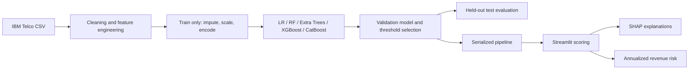

# Customer Churn Prediction & Revenue Risk Analysis

An end-to-end, reproducible churn modeling application using IBM's 7,043-row Telco Customer Churn sample. It trains multiple classifiers, selects a decision threshold using validation F1, reports untouched test performance, ranks customers by expected annualized revenue risk, and provides a Streamlit dashboard with SHAP explanations.

## Live demo

**[Open the live churn and revenue risk dashboard](https://customer-churn-prediction-revenue-risk-knfld5hswatebetuwn89vd.streamlit.app/)** · [Browse the source code](https://github.com/Integenpiyush/customer-churn-prediction-revenue-risk)

The public dashboard uses the committed model and aggregate reports; it does not expose customer-level records.

> **Risk interpretation:** expected revenue at risk is `P(churn) × monthly charges × 12`. It is an annualized risk proxy, not customer lifetime value and not revenue guaranteed to be lost.

## Project layout

```text
app.py                         Streamlit dashboard
src/churn/features.py          Cleaning and deterministic feature engineering
src/churn/train.py             Stratified split, model comparison, evaluation, artifacts
src/churn/eda.py               EDA charts and data quality summary
src/churn/risk.py              Risk calculation and customer prioritization
src/churn/explain.py           SHAP explanation helper
data/raw/                      ignored local IBM CSV cache
artifacts/                     Trained pipeline and actual metrics
reports/                       EDA figures, comparison and risk report
tests/                         Unit tests
```



## Data and EDA

Source, terms caveat and missing-value decisions are documented in [docs/data.md](docs/data.md). Training and EDA fetch the CSV from IBM when no local copy is present; run `python -m src.churn.data` to save it locally. The deployed dashboard uses committed aggregate reports and model artifacts, so it does not fetch or display customer-level records. The source data contains 7,043 rows, 21 columns (19 predictors plus ID and target), a roughly 26.5% churn rate, and 11 blank `TotalCharges` values for zero-tenure customers. EDA charts cover class balance, contract, tenure, monthly charges, payment method and numeric correlations. The run also writes churn segment rates, categorical Cramer's V associations and IQR outlier review tables; flagged values are retained because they are plausible billing/customer observations. Run `python -m src.churn.eda` to rebuild the outputs. The generated summary records missingness and duplicate counts.

## Modeling methodology

The seeded split is stratified into 70% train, 10% validation and 20% test (test n=1,409). ID is dropped. Training-fold preprocessing uses median imputation and scaling for numerics, and most-frequent imputation plus one-hot encoding for categoricals. Validation selects the model and its F1-maximizing probability cutoff; the test set is held back until that decision is fixed. Candidate models are class-weighted Logistic Regression, Random Forest, Extra Trees, XGBoost, and CatBoost when installed. XGBoost receives a four-configuration randomized search with three-fold CV on training only. Five-fold training CV is reported for the selected model. Model selection is experimental; no algorithm is assumed to win.

Feature engineering adds tenure and monthly charge bands, month-to-month indicator, service count, and total-charge per tenure-month. `customerID` is never used as a feature. Derived values are calculated by the same `prepare_frame` function at inference.

For a binary classifier, precision is `TP/(TP+FP)`, recall is `TP/(TP+FN)`, and F1 is their harmonic mean. ROC-AUC measures ranking across thresholds; PR-AUC summarizes precision-recall behavior and is useful under class imbalance. Class weights increase the training penalty on churn errors. Reported test results are generated from this code and the IBM source dataset, not copied from historical benchmarks.

## Install and run

```bash
python -m venv .venv
source .venv/bin/activate
pip install -r requirements-dev.txt
python -m src.churn.data
python -m src.churn.eda
python -m src.churn.train
pytest -q
streamlit run app.py
```

Training saves a serialized sklearn pipeline to `artifacts/churn_model.joblib`, test metrics to `artifacts/metrics.json`, model comparison to `reports/model_comparison.csv`, aggregate test risk to `artifacts/revenue_risk.json`, aggregate segment risk to `reports/risk_segment_summary.csv`, and SHAP global importance plots/table under `reports/`. Set `EXPORT_CUSTOMER_LEVEL_REPORTS=1` to write the customer-level risk export to the ignored `data/private/` folder for local use. Individual customer records are excluded from the public repo and dashboard; the Revenue Risk page shows segment aggregates. The dashboard includes Overview, Customer Analytics, Model Performance, Customer Prediction, Revenue Risk, and Explainability pages. SHAP explanations summarize model behavior, not causal drivers.

## Reproduced results

On the untouched stratified test set (n=1,409), validation selected tuned XGBoost at threshold 0.289. It achieved accuracy 0.759, precision 0.531, recall 0.767, F1 0.628, ROC-AUC 0.841 and PR-AUC 0.672. The selected model's five-fold training CV F1 mean was 0.588. Logistic Regression at the default 0.5 cutoff achieved test F1 0.632, so the selected XGBoost model did **not** improve on that baseline on test; the historical approximately 20.6% improvement was not reproduced. Candidate validation-selected threshold test results: Logistic Regression F1 0.650 / ROC-AUC 0.855; Random Forest 0.642 / 0.841; CatBoost 0.638 / 0.849; Extra Trees 0.630 / 0.837; XGBoost 0.628 / 0.841. Selection was based only on validation F1, which was highest for XGBoost; test results are reported after selection and are not used to retune.

For the 1,409 test customers, the expected annualized revenue-risk proxy is **$321,311**. The top 140 by risk account for **$110,815 (34.5%)**. The historical $488,415 test risk and 27% top-decile share were not reproduced. CatBoost was trained and compared. SHAP global importance was computed on a held-out 250-row sample; its highest mean absolute attributions were month-to-month indicator (0.546), tenure (0.505), OnlineSecurity=No (0.257), and Fiber optic internet service (0.214). This is attribution, not causal evidence. All tests, including a SHAP output check, passed in the final environment.

## Revenue risk and retention

Per-customer risk is probability times monthly charge times 12. Customers are sorted by this expected annualized amount. The top decile is defined by customer count and reports the share of total modeled risk it contains. The customer report includes heuristic suggestions such as renewal outreach for high-risk month-to-month customers or billing support for electronic-check accounts. Retention teams can use probability, revenue exposure, contract, tenure and payment method to prioritize outreach; the model does not estimate treatment effectiveness or campaign cost.

## Deployment

The app is deployed on Streamlit Community Cloud from `app.py` using `requirements.txt`. It loads the committed model and aggregate reports at startup. Training and EDA fetch the source CSV from IBM when no local copy is present; the hosted app does not download the CSV.

## Limitations and next steps

This is a historical sample dataset, not a live telecom feed; feature timing and drift are unknown. Risk estimates assume 12 months of current monthly charges and omit discounts, variable usage, margin, retention costs and actual lifetime. SHAP attribution is descriptive. No causal campaign uplift is inferred. Future work: time-based validation, calibration and cost-sensitive thresholds, campaign uplift modeling, monitoring/drift alerts, fairness review, and live CRM integration.
